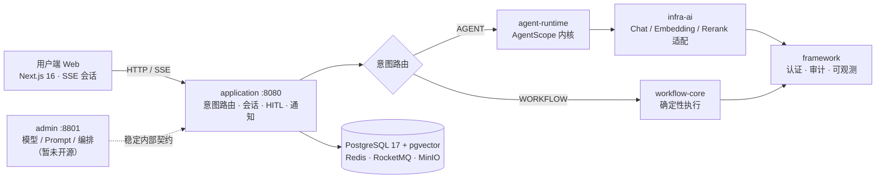

<p align="center">
  
</p>

<h1 align="center">Lingxi Workbench</h1>

<p align="center">
  <strong>意图路由驱动的企业级 AI 工作台</strong><br/>
  Intent-routed AI workbench with dual Agent / Workflow engines
</p>

<p align="center">
  
  
  
  
  
  
  
</p>

---

用户消息不直接进入模型：先经**意图树路由**（槽位校验、路由证据落库），再按意图类型分派执行——**AGENT** 叶子锁定已发布 Agent 版本、由 AgentScope 内核执行，**WORKFLOW** 叶子进入确定性工作流引擎，固定应答与澄清不进任何引擎。在此之上提供模型接入、Prompt 版本管理、知识库 RAG、工具与 MCP 协议接入、人机协同（HITL）与定时触发的主动任务。

<!-- 建议发布前补 2 张截图：web 端 SSE 会话 + 执行轨迹；管理端应用编排 -->

## 功能特性

| 能力 | 说明 |
| --- | --- |
| 意图路由 | 意图树管理、槽位类型校验、路由证据（命中路径 / 阈值 / 分数）落库观测 |
| Agent 引擎 | AgentScope 内核、Supervisor / Specialist 多 Agent 网关、技能目录、Checkpoint 中断恢复 |
| Workflow 引擎 | 版本化定义、快照、执行与事件 append-only，可重放可审计 |
| 知识库 RAG | pgvector 检索、查询改写、Rerank、上下文有界去重并保留来源 |
| 人机协同（HITL） | 高危工具调用产生 Checkpoint 中断，审批后从断点续跑，过期协议自动扫描恢复 |
| 主动任务 | 定时触发器（Trigger）驱动主动运行，站内通知中心触达 |
| 模型与 Prompt | 供应商 API Key 加密入库、Prompt 版本绑定运行时、内置变量目录 |
| 协议接入 | 独立 MCP Server 暴露 Tool / Resource / Prompt；HTTP / SSE 用户接口 |

## 架构



| 目录 | 内容 |
| --- | --- |
| [`server/`](./server) | Java 21 / Spring Boot 4.1，七模块 Maven reactor：`framework` → `infra-ai` → `agent-runtime` / `workflow-core` → `application` / `admin` / `mcp-server`，依赖单向、模块职责与分层约束见 [server/AGENTS.md](./server/AGENTS.md) |
| [`web/`](./web) | Next.js 16 / React 19 / LobeUI：SSE 流式会话、执行轨迹可视化、通知中心、触发器管理 |

## 快速开始

环境要求：JDK 21、Node.js 22+、pnpm 10+、Docker。

```bash
# 1. 启动依赖容器（PostgreSQL 17 + pgvector、Redis、MinIO、RocketMQ）
cd server
./scripts/dev-start.sh

# 2. 初始化数据库（按序执行全部迁移脚本）
./scripts/init-db.sh

# 3. 启动用户端服务 :8080（管理端 :8801 同理）
./mvnw -pl application -am spring-boot:run

# 4. 启动前端 :3000
cd ../web
cp .env.example .env.local
pnpm install && pnpm dev
```

默认配置与 `compose.yml` 对齐，无需 `.env` 即可启动；模型供应商 API Key 在管理端「模型管理」录入并加密入库，不落配置文件。覆盖部署见 [`server/.env.example`](./server/.env.example)。

## 工程质量

- **881 个测试用例 / 210 个测试类**，覆盖失败路径、权限、状态流转、事务、幂等与外部边界；`./scripts/verify.sh` 全量门禁
- 授权 SQL 语义独立回归（SQLite 重放生产 Mapper）、知识库检索质量评估脚本
- 数据库无物理外键，引用完整性在服务层校验；统一审计、幂等、逻辑删除与 Project Scope 过滤
- 设计文档沉淀于 [`server/docs/development/`](./server/docs/development/)

## Roadmap

- [ ] Flyway 迁移自动化（替换脚本式初始化）
- [ ] 管理端（`admin`）开源
- [ ] 评估中心：意图路由与 RAG 质量报表

## 致谢

- [AgentScope](https://github.com/agentscope-ai/agentscope) — Agent 执行内核
- [LobeUI](https://github.com/lobehub/lobe-ui) — Web 端设计系统（MIT）

## License

[Apache-2.0](./LICENSE) © 2026 Lingxi Workbench Contributors
