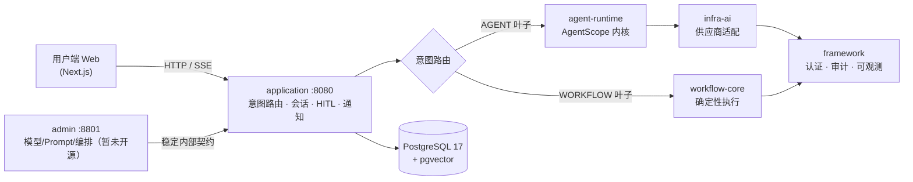

# Lingxi Workbench

开源的企业级 AI 工作台：用户消息先经**意图路由**，再分派 **Agent / Workflow 双引擎**执行——覆盖模型接入、Prompt 版本管理、知识库 RAG、工具与 MCP 协议、人机协同（HITL）与定时触发的主动任务。

     

## 产品闭环

- **用户端**（[`web/`](./web)，Next.js 16 / React 19）：SSE 流式会话、执行轨迹可视化、通知中心、定时触发器管理
- **服务端**（[`server/`](./server)，Java 21 / Spring Boot 4.1）：七模块 Maven reactor，`application`（用户端服务）与 `admin`（管理端服务，暂未开源）完全隔离，跨服务只走稳定 HTTP 契约



## 核心设计决策

- **意图路由先行**：只有 WORKFLOW 叶子进工作流引擎、AGENT 叶子锁定已发布版本执行，固定应答与澄清不进任何引擎；路由证据落库可观测
- **Agent 内核与供应商解耦**：`agent-runtime` 基于 AgentScope，不依赖 Spring AI；模型输出一律视为不可信，工具入参校验、高危动作转人工确认
- **HITL 不绕过引擎**：高危工具调用产生 checkpoint 中断，审批后从断点续跑，RocketMQ 事务消息保证一致性
- **Workflow 版本、快照、执行与事件 append-only**，可重放可审计
- **880+ 测试用例 / 210 个测试类**贯穿失败路径、权限、状态流转、事务与幂等

完整架构与工程约束见 [`server/README.md`](./server/README.md) 与 [`server/AGENTS.md`](./server/AGENTS.md)。

## 快速开始

```bash
cd server
./scripts/dev-start.sh    # PostgreSQL 17 + pgvector / Redis / MinIO / RocketMQ
./scripts/init-db.sh      # 按序执行全部数据库迁移
./mvnw -pl application -am spring-boot:run   # 用户端服务 :8080

cd ../web
cp .env.example .env.local && pnpm install && pnpm dev   # 前端 :3000
```

零配置启动：默认值与 `compose.yml` 对齐，模型 API Key 在管理端「模型管理」录入、加密入库，不落配置文件。详见 [server/README.md](./server/README.md)。

## License

[Apache-2.0](./LICENSE)
