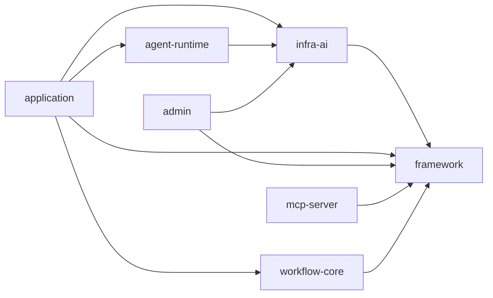

# Lingxi Workbench Server

企业级 AI 工作台后端：意图路由分派 **Agent / Workflow 双引擎**，覆盖模型接入、Prompt 版本、知识库 RAG、工具与 MCP、人机协同（HITL）与主动任务的完整闭环。

     

用户端前端见 [lingxi-workbench-web](../web)（Next.js 16 / React 19，SSE 流式会话）。

## 核心设计

**意图路由先行，双引擎分派。** 用户消息不直接进模型，先经意图树路由：仅 WORKFLOW 叶子进入确定性 Workflow 执行器，AGENT 叶子锁定已发布 AgentVersion 执行，固定应答与澄清话术不进任何引擎。路由带槽位类型校验，并落库路由证据（命中路径、阈值、分数）供观测与评估。

**Agent 内核与 AI 供应商解耦。** `agent-runtime` 以 AgentScope 为执行内核，通过 Supervisor / Specialist 网关组织多 Agent 协作，不依赖 Spring AI；供应商差异（Chat / Embedding / Rerank / Tokenizer）收敛在 `infra-ai`，向上层不暴露 SDK 对象。模型输出一律视为不可信：工具入参校验、权限复核、高危动作转 HITL。

**HITL 基于执行中断实现，而非绕过引擎。** 高危工具调用产生 checkpoint 中断（含过期协议与扫描恢复），审批通过后从 checkpoint 续跑原计划，配合 RocketMQ 事务消息保证会话事件与业务状态一致。

**Workflow 版本、快照、执行与事件 append-only。** 工作流定义走版本化管理，运行产生不可变事件流，支持重放与审计。

**知识库 RAG 约束内建。** pgvector 存储，embedding 模型、维度、距离类型与索引版本四要素绑定一致；检索上下文有界去重并保留来源。

**工程质量作为一等约束。** 七模块 Maven reactor 单向依赖；`admin` 与 `application` 两个可运行业务服务完全隔离，跨服务只走稳定 HTTP 契约；数据库无物理外键，引用完整性与生命周期在服务层校验；统一审计、幂等、逻辑删除与 Project Scope 过滤贯穿全链路。

## 架构

| 模块 | 职责 | 可独立启动 |
| --- | --- | --- |
| `framework` | 认证、缓存、数据库、统一审计、幂等、可观测性等通用技术能力 | 否 |
| `infra-ai` | AI 公共契约、Prompt 内置变量目录，Chat / Embedding / Rerank / Tokenizer 供应商适配 | 否 |
| `agent-runtime` | AgentScope 内核封装：Supervisor/Specialist 网关、技能目录、checkpoint 中断恢复 | 否 |
| `workflow-core` | 确定性工作流原语：节点语义、快照、执行与事件 | 否 |
| `application` | 用户端业务：会话、意图路由、执行大脑、知识库、HITL、通知、Trigger 主动任务（`:8080`） | 是 |
| `admin` | 管理端业务：模型配置、Prompt 模板、应用与工作流编排、审计（`:8801`） | 是 |
| `mcp-server` | 独立 MCP 协议入口，暴露 Tool / Resource / Prompt | 是 |



依赖方向固定且不可反向：`framework` 不含业务；`infra-ai` 不决定业务流程；`admin` 与 `application` 不共享实体、Repo 或服务。业务模块内统一 `Controller -> Service -> Repo -> Mapper` 分层，完整工程约束见 [AGENTS.md](./AGENTS.md)。

## 快速开始

环境要求：JDK 21、Docker。

```bash
# 1. 启动本地依赖（PostgreSQL 17 + pgvector、Redis、MinIO、RocketMQ）
./scripts/dev-start.sh

# 2. 初始化数据库：按序执行 resources/database/postgresql/migration 下的全部迁移
./scripts/init-db.sh

# 3. 预下载依赖（可选）
./scripts/bootstrap.sh

# 4. 启动用户端服务（:8080）与管理端服务（:8801）
./mvnw -pl application -am spring-boot:run
./mvnw -pl admin -am spring-boot:run
```

默认配置与 `compose.yml` 容器对齐，无需 `.env` 即可启动；覆盖默认部署时参考 [`.env.example`](./.env.example)。模型供应商 API Key 不落在配置文件中：启动后在管理端「模型管理」录入，由 `infra-ai` 统一适配调用。

全量构建与测试：

```bash
./scripts/verify.sh          # 等价于 ./mvnw clean verify
```

## 技术栈

Java 21 · Spring Boot 4.1 · Spring AI 2.0（供应商适配）· AgentScope 2.0（Agent 内核）· Sa-Token · MyBatis-Plus · PostgreSQL 17 + pgvector · Redis · RocketMQ · MinIO · Langfuse/OTLP（可选观测）

## 测试与质量

- 210 个测试类、881 个测试用例，覆盖失败路径、权限、状态流转、事务、幂等与外部边界。
- `scripts/tests/` 用 SQLite 重放生产 Mapper 中的授权 SQL，对数据权限语义做独立回归。
- `scripts/knowledge-evaluation/` 提供知识库检索质量评估脚本。

## 开发文档

- [SSE 真实流式传输问题记录](docs/development/sse-streaming-transport.md)
- [Agent Runtime 内核收敛设计](docs/development/agent-runtime-core-convergence-v1.md)
- [应用执行大脑代码设计](docs/development/application-execution-brain-code-design-v1.md)

## License

[Apache-2.0](./LICENSE)
